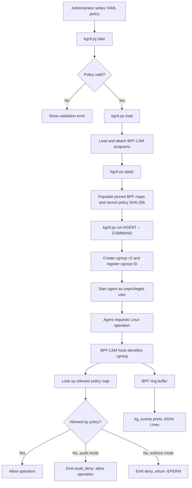

# KernelGuard Zero Trust Policy Guide

This guide explains the **implemented policy model** in the canonical source tree, `kernelguard/`. It is intended for a code reviewer who wants to understand what the ZTA policy checks, where the rules are stored, how they reach the Linux kernel, and what happens when an agent violates a rule.

> **Scope:** This describes the current BPF-LSM implementation. It does not claim that the kernel understands prompts, model reasoning, encrypted HTTPS contents, or every possible Linux operation.

## 1. What Zero Trust means in KernelGuard

Zero Trust means that a managed agent is not trusted merely because it is running on the machine or because it was started by an approved AI framework. For each operation covered by KernelGuard, the system identifies the workload and checks the operation against administrator-defined policy.

The practical rules are:

1. **Identify the workload:** use the controller-created cgroup v2 identity, not a PID or process name.
2. **Check explicit permissions:** allow only executable identities listed for that agent.
3. **Protect sensitive data:** deny configured sensitive files or mark the workload as tainted after it reads them.
4. **Constrain network access:** apply an IPv4 destination/port allow-list when the agent is configured for default-deny egress or has been tainted.
5. **Keep policy outside the agent's control:** the administrator applies the YAML policy; the agent runs as an unprivileged account.
6. **Fail closed for covered violations in enforce mode:** a denied operation returns `-EPERM`. In audit mode the same would-be violation is logged but allowed to continue.

Zero Trust is not a claim that every Linux syscall is mediated. KernelGuard checks the specific hooks and conditions listed below.

## 2. High-level policy flow



The BPF-LSM hook is the synchronous decision point. The ring buffer is for telemetry; the event reader does not make the allow/deny decision.

## 3. Who creates and protects the policy?

### Administrator responsibility

The administrator owns and edits the YAML file, for example:

- `kernelguard/policy/policy.example.yaml`
- `kernelguard/policy/policy.hardened.yaml`

The agent does not receive a policy-editing API. The controller requires root for operations such as loading BPF, applying maps and starting a managed workload. The managed process is deliberately started with a non-root UID/GID, cleared supplementary groups, a minimal environment and `PR_SET_NO_NEW_PRIVS`.

### Policy integrity check

When `kgctl.py apply` applies a policy, it records the policy file path and SHA-256 digest in the controller state. Before `kgctl.py run` starts an agent, it hashes the file again. If the file changed after apply, the controller refuses to start the workload and asks the operator to apply the policy again.

This detects policy-file drift between apply and run. It is not a digital signature or a secure secret vault. The administrator must still keep the policy file, controller state and pinned BPF objects protected by appropriate root ownership and filesystem permissions.

### Why the agent cannot simply grant itself permission

The policy decision is not taken from an instruction supplied by the model. The model can ask its tool to execute a command, but the resulting Linux operation reaches the BPF-LSM hook. The hook consults the BPF maps populated by the privileged controller. The agent's prompt cannot add an entry to those maps.

This assumes the Linux kernel and privileged host administrator are trusted. A host-root compromise is outside the current threat model.

## 4. Workload identity: cgroup v2

KernelGuard uses a dedicated cgroup v2 for each managed run.

1. The controller creates a cgroup directory for the agent run.
2. It obtains the cgroup ID from the directory inode.
3. It inserts an entry into the `agent_cgroups` BPF map. The value includes the configured agent ID, audit/enforce mode and default egress setting.
4. The child process joins the cgroup before it drops privileges and executes the requested command.
5. Descendant processes inherit cgroup membership.
6. At a monitored operation, BPF calls `bpf_get_current_cgroup_id()` and looks up that ID in `agent_cgroups`.

If the cgroup ID is not registered, the current BPF hooks do not apply KernelGuard agent policy to that process.

**Why not use PID?** PIDs can change across forks and be reused after process exit. A cgroup groups the managed process tree, so the identity follows its descendants.

**What this identity proves:** the operation belongs to a workload that the controller placed in a registered cgroup. It does not cryptographically prove which model, prompt, user instruction or document caused the operation.

## 5. Policy file: what each section means

The following is a shortened illustration. The repository's example policy is the authoritative schema and includes concrete paths and network entries.

```yaml
version: 1

sensitive:
  taint:
    - ".env"
    - "id_rsa"
    - "credentials"
  deny:
    - "shadow"
    - "sudoers"

agents:
  research_agent:
    id: 1
    mode: audit
    run_as: kgagent
    workdir: /var/lib/kernelguard/work/research_agent

    limits:
      pids_max: 64
      memory_max: 1073741824

    exec:
      allow:
        - /usr/bin/python3
        - /usr/bin/ls
        - /usr/bin/cat
        - /usr/bin/whoami

    network:
      egress_default: deny
      allow:
        - {host: generativelanguage.googleapis.com, port: 443}
        - {ip: 127.0.0.53, port: 53}
```

| YAML field | Meaning |
|---|---|
| `version` | Policy schema version. Current schema requires `1`. |
| `sensitive.taint` | Filename components whose open is allowed but taints the agent's cgroup. |
| `sensitive.deny` | Filename components whose open is a policy violation. |
| `agents.<name>.id` | Unique numeric agent ID in the supported range 1–63. |
| `mode` | Required `audit` or `enforce`; no implicit default. |
| `run_as` | Existing unprivileged Linux account used for the workload. Root is refused. |
| `workdir` | Working directory owned by the configured run-as account. |
| `env_passthrough` | Names of selected environment variables copied into the child environment. Never put secret values in YAML. |
| `limits.pids_max` | cgroup process-count limit. |
| `limits.memory_max` | cgroup memory limit in bytes. |
| `exec.allow` | Executable files the agent may launch. |
| `network.egress_default` | `deny` restricts unlisted IPv4 destinations from the start; `allow` allows ordinary egress until the cgroup becomes tainted. |
| `network.allow` | IPv4 address or hostname plus port(s) permitted when egress is restricted. |

Policy validation rejects invalid agent IDs, duplicate IDs, unsupported modes, empty executable allow-lists, malformed network entries, invalid ports, and sensitive names that contain a slash or exceed the fixed key length.

## 6. How each security rule works

### 6.1 Executable allow-list

**Hook:** `bprm_check_security`  
**Map:** `exec_allow`

The controller resolves each configured executable path and obtains its device and inode. It writes an allow entry keyed by:

`(agent_id, device, inode)`

When a managed agent launches a program, the BPF hook obtains the executable inode/device and the agent ID from the registered cgroup. If the key exists, execution is allowed. If it does not, KernelGuard records a violation.

This is stronger than comparing only a user-provided path string. Symlink names and copied files do not automatically match the approved inode. If an executable is replaced with a different inode, it will not match the old allow entry. An optional SHA-256 field in the YAML can additionally be checked by the controller when building/applying the policy.

**Important limitation:** allowing `/usr/bin/python3` allows that interpreter to run scripts. The executable allow-list does not inspect Python source code or sandbox every action performed inside an allowed interpreter.

### 6.2 Sensitive-file deny rules

**Hook:** `file_open`  
**Map:** `sensitive_names`

The hook reads the final filename component of the resolved file being opened and looks it up in the sensitive-name map.

If the action is `deny`, the hook records a violation. In enforce mode it returns `-EPERM`; in audit mode it records `audit_deny` and lets the open continue.

The current sensitive-name map is **global**, not separately keyed by agent ID. Matching is by final filename component, not a complete path policy or a full read/write/rename/delete mediation system.

### 6.3 Sensitive-file taint

**Hook:** `file_open`  
**Maps:** `sensitive_names`, `agent_state`

A name in `sensitive.taint` is not denied at open time. Instead:

1. The file open is allowed.
2. KernelGuard sets a taint flag in `agent_state`, keyed by the agent's cgroup ID.
3. It records a `taint` event.
4. Later network operations for that cgroup are treated as restricted.

Taint is therefore attached to the workload, not just to the individual process that opened the file. Descendants in the same cgroup share the workload identity.

The current implementation records the taint state; it does not track individual bytes or prove that a particular secret was included in a network payload.

### 6.4 Network egress allow-list

**Hooks:** `socket_connect`, `socket_sendmsg`  
**Map:** `egress_allow`

The egress map key contains:

`(agent_id, IPv4 address, port)`

A port value of zero is used for an address-wide wildcard rule. The hook checks both the exact address/port and the wildcard-port entry.

Egress becomes restricted when either:

- the agent's `egress_default` is `deny`; or
- the agent's cgroup has been marked tainted by a sensitive-file read.

When restricted, an IPv4 destination must match the agent's allow-list. Otherwise it is a policy violation.

The current allow-list is IPv4-only. For IPv6, the code does not have an IPv6 allow map: when egress is restricted, IPv6 destinations are treated as unlisted and denied; when egress is not restricted, IPv6 is allowed. AF_UNIX, AF_NETLINK and other non-IP address families are not treated as external IP egress by this hook.

The hook checks destination metadata, not HTTPS contents, URL paths, DNS query meaning or the data being transmitted.

### 6.5 BPF and ptrace self-protection

**Hooks:** `bpf`, `ptrace_access_check`

Attempts by a registered agent to use the BPF syscall or ptrace are treated as policy violations. Audit mode logs and permits the operation; enforce mode returns `-EPERM`.

### 6.6 Resource and privilege restrictions

These are controller/cgroup protections, not BPF-LSM map lookups:

- The workload must run as a non-root account.
- Supplementary groups are cleared before execution.
- `no_new_privs` is set before exec.
- The child receives a minimal environment; only explicitly named environment variables are passed through.
- cgroup `pids.max` and `memory.max` can constrain resource consumption.

The API key example is passed as an environment variable to the agent when configured. That means the agent process can read it; environment filtering is not a secret vault.

## 7. BPF maps: the policy data used by the kernel

| Map | Key | Value / purpose |
|---|---|---|
| `agent_cgroups` | cgroup ID | Agent ID, mode and default egress setting. Presence identifies a managed workload. |
| `exec_allow` | agent ID + device + inode | Marks an executable identity as permitted for that agent. |
| `sensitive_names` | fixed-size filename component | Action: taint or deny. This map is global. |
| `egress_allow` | agent ID + IPv4 address + port | Marks a destination as allowed while egress is restricted. |
| `agent_state` | cgroup ID | Runtime flags, including whether sensitive data was accessed. |
| `stats` | hook/verdict index | Per-CPU decision counters. |
| `events` | ring-buffer record | Sends event details to the user-space reader. |

The shared C structures are in `kernelguard/bpf/kg_common.h`. The controller's Python `pack_*` functions mirror these binary layouts. `tests/test_kgctl.py` checks that the Python and C layouts agree.

## 8. Audit mode versus enforce mode

| Situation | Audit mode | Enforce mode |
|---|---|---|
| Operation matches allow policy | Allow | Allow |
| Operation violates policy | Emit `audit_deny`, return success | Emit `deny`, return `-EPERM` |
| Sensitive taint filename opened | Mark cgroup tainted; allow open | Mark cgroup tainted; allow open |
| Sensitive deny filename opened | Log would-deny; allow open | Deny open with `-EPERM` |

A `taint` event is not a deny. It means the file open was allowed and the workload state changed.

**Safe rollout:**

1. Run `plan` to validate the policy.
2. Use `audit` mode with a normal workload.
3. Inspect `audit_deny` events and add only legitimate required executables/destinations.
4. Review the policy with the administrator.
5. Switch the relevant agent to `enforce` in a disposable VM.
6. Repeat each test and confirm the expected `deny` event and application-level `EPERM` result.

Do not interpret a successful `plan`, compilation or BPF load as proof that a specific operation was blocked.

## 9. Policy lifecycle commands

Run these from `kernelguard/`:

```bash
# 1. Validate and preview map entries (no root, no BPF changes)
python3 kgctl.py plan -p policy/policy.example.yaml

# 2. Build the BPF object and event reader
make

# 3. Check runtime prerequisites
sudo python3 kgctl.py doctor

# 4. Load and attach BPF-LSM programs (disposable VM only)
sudo python3 kgctl.py load

# 5. Apply administrator policy to the pinned BPF maps
sudo python3 kgctl.py apply -p policy/policy.example.yaml

# 6. Inspect loaded policy and counters
sudo python3 kgctl.py status

# 7. Run a small managed command (the sample policy is audit mode)
sudo python3 kgctl.py run research_agent -- /usr/bin/python3 --version

# 8. In another terminal, stream JSON event records
sudo python3 kgctl.py events

# 9. Stop and detach only this test instance, after checking ownership
sudo python3 kgctl.py unload
```

The sample policy is in audit mode. Live BPF loading and unloading should be done only in a disposable VM after checking that no other workload owns the relevant BPF programs, links or pins.

## 10. Operator response tiers

For a currently running managed workload, the controller supports:

| Tier | Action |
|---|---|
| `observe` | Keep current policy unchanged. |
| `restrict` | Change the running agent to enforce mode and set default egress deny. |
| `freeze` | Suspend processes in the agent cgroup. |
| `thaw` | Resume a frozen cgroup. |
| `kill` | Terminate processes in the agent cgroup. |

These actions require the privileged controller. The `restrict` tier updates the cgroup's BPF agent configuration; it is not an LLM decision.

## 11. What ZTA does not currently do

- It does not parse prompts or detect prompt injection semantically.
- It does not inspect model chain-of-thought or tool arguments before the tool executes.
- It does not inspect encrypted HTTPS request bodies or URLs.
- It does not implement an IPv6 destination allow-list.
- It does not mediate every Linux syscall or every file operation.
- It does not make sensitive filename rules per-agent.
- It does not prevent a permitted interpreter from running malicious scripts by itself.
- It does not protect a host after kernel or root compromise.
- The separate behavioural ML modules are advisory/offline and are not called synchronously from the BPF hook. LLM semantic adjudication is not implemented in this canonical runtime path.

## 12. Suggested code-review walkthrough

For a 15-minute explanation, open the files in this order:

1. `kernelguard/policy/policy.example.yaml` — show what the administrator configures.
2. `kernelguard/kgctl.py` — explain validation, map planning, policy hash, cgroup creation and privilege drop.
3. `kernelguard/bpf/kg_common.h` — explain the map keys, values, hook IDs and event structure.
4. `kernelguard/bpf/kg_zta.bpf.c` — explain cgroup lookup, executable check, file-open check, taint, network check and audit/enforce return value.
5. `kernelguard/tools/kg_events.c` — show how ring-buffer records become JSON Lines.
6. `kernelguard/tests/test_kgctl.py` and `kernelguard/tests/dry_run.sh` — show reproducible safe validation.
7. `kernelguard/detection/` — explain that ML risk assessment is a separate advisory research component, not kernel enforcement.

The most important explanation to remember is: **the AI agent requests an operation; the controller-established cgroup identifies the workload; the BPF-LSM hook checks the administrator's policy map; audit mode logs a would-deny decision, while enforce mode returns `-EPERM` for a covered violation.**
