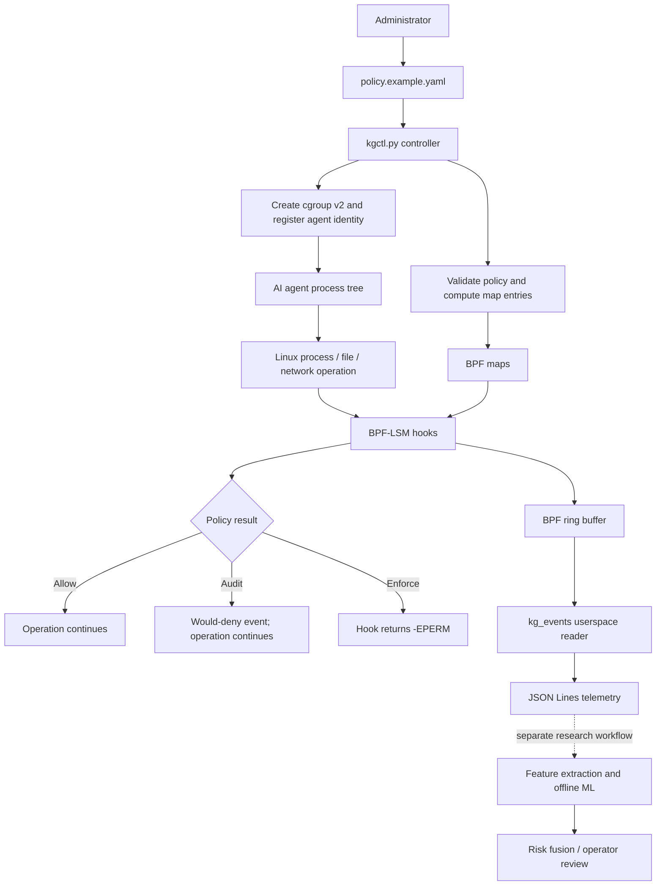

# KernelGuard architecture

## Component responsibilities

| Component | Source | Responsibility | Main input | Main output |
|---|---|---|---|---|
| Controller | `kernelguard/kgctl.py` | Validates policy, manages BPF lifecycle, creates agent cgroups, drops privileges, reports status and manages response tiers | YAML policy and command arguments | BPF map entries, cgroup registration, status and event stream |
| BPF-LSM program | `kernelguard/bpf/kg_zta.bpf.c` | Intercepts selected Linux security operations and performs policy lookups | Current process identity, hook arguments and BPF maps | Allow, audit decision or deny; ring-buffer record |
| Shared ABI | `kernelguard/bpf/kg_common.h` | Defines map keys, values, hook IDs, verdict IDs and event record layout shared by kernel and user space | C type definitions | Consistent binary layouts |
| Policy example | `kernelguard/policy/policy.example.yaml` | Demonstrates administrator-owned executable, sensitive-file and egress policy | Administrator configuration | Validated policy input |
| Event reader | `kernelguard/tools/kg_events.c` | Reads the pinned BPF ring buffer and writes one JSON object per event | Ring-buffer records | JSON Lines on stdout |
| Agent example | `kernelguard/agent/langchain_gemini_agent.py` | Demonstrates a tool-using LangChain agent with a restricted set of local tools | User task and external Gemini API response | Tool invocation and agent response |
| Unit tests | `kernelguard/tests/test_kgctl.py` | Checks policy validation and Python/C data layout | Test policies and temporary files | Pass/fail test results |
| Dry-run validation | `kernelguard/tests/dry_run.sh` | Runs syntax, policy and unit checks without BPF attachment | Local source tree | Safe validation summary |
| Behaviour features | `kernelguard/detection/behavior_features.py` | Extracts run-level behavioural features from compatible tabular events | DataFrame with documented columns | 23-feature vector |
| ML inference | `kernelguard/detection/behavior_ml.py` | Loads separately supplied model artifacts and predicts a behavioural risk | Feature vector and joblib artifacts | Prediction, probability and risk label |
| Risk fusion | `kernelguard/detection/risk_fusion.py` | Combines ZTA decision and ML risk as an advisory result | ZTA decision and ML risk | ALLOW, DENY or REVIEW |

## Runtime flow

## Important architectural boundary

The BPF-LSM hook is the synchronous decision point for the operations covered by the policy. The behavioural ML workflow is separate and advisory in the current repository. It is not called synchronously inside the kernel hook and does not directly block a syscall.

The existing dataset collectors use a legacy text-log schema. The canonical event reader produces JSON Lines. Do not treat those formats as interchangeable until a tested adapter is implemented.

## Suggested walkthrough order

1. `kgctl.py`: policy lifecycle and cgroup-based workload registration.
2. `policy/policy.example.yaml`: administrator-defined permissions.
3. `bpf/kg_common.h`: shared structures and hook/verdict identifiers.
4. `bpf/kg_zta.bpf.c`: LSM hooks, map lookups and enforcement return values.
5. `tools/kg_events.c`: ring-buffer ABI and JSON output.
6. `tests/test_kgctl.py` and `tests/dry_run.sh`: reproducible safe validation.
7. `detection/`: explain the separate offline/advisory ML research workflow.
